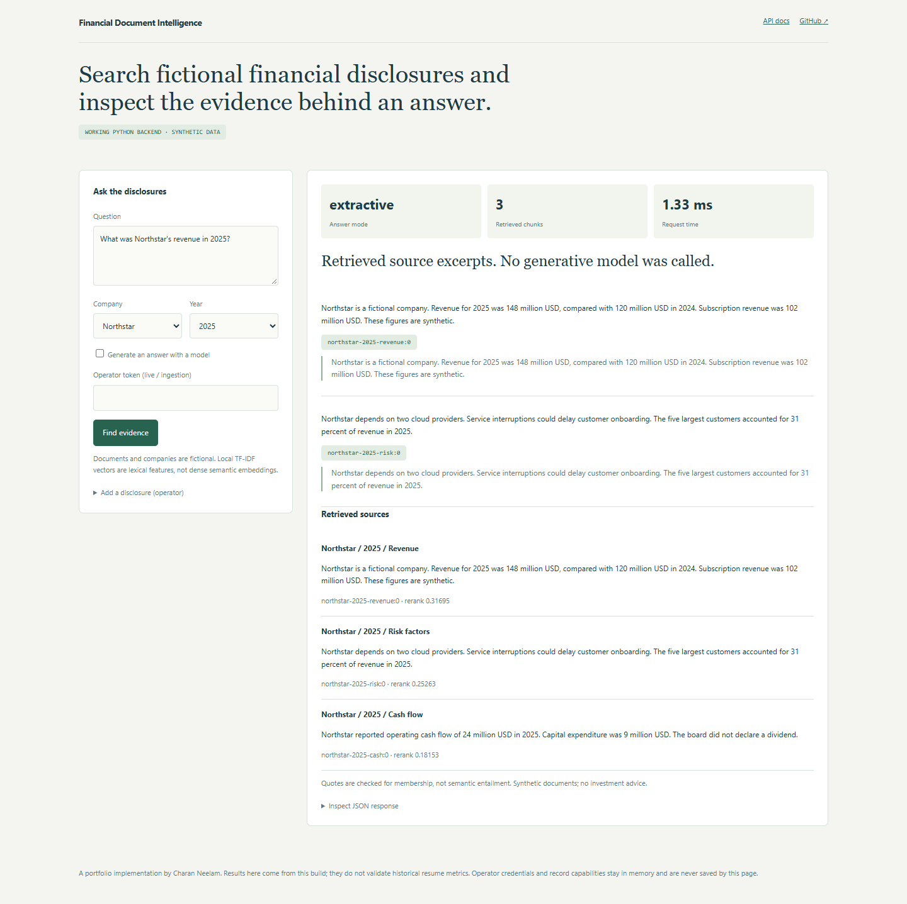
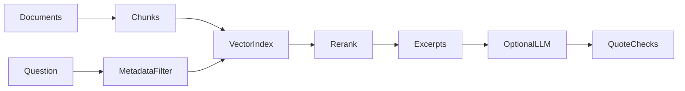

# Financial Document Intelligence


[](https://github.com/charanneelam123-dot/financial-document-intelligence/actions/workflows/test.yml)


**[Open the live app](https://financial-document-intelligence-o3k2.onrender.com)** · [API documentation](https://financial-document-intelligence-o3k2.onrender.com/docs)


A useful answer should make the disclosure behind it easy to inspect.


The application ingests fictional disclosures, chunks them with overlap, and

builds a normalized TF-IDF vector index. It filters by company and year before

returning candidates, then reranks them with vector similarity and term coverage.

The default answer contains retrieved excerpts. Optional model generation must

cite an exact quote from a retrieved chunk.


The operator can index another UTF-8 disclosure through the API or the browser.

Document metadata and text live in SQLite; the vector index is rebuilt on startup.

The demo caps the collection at 200 documents and never uploads the supplied resume.


TF-IDF is a lexical vector baseline, not dense semantic embedding search. It can

miss paraphrases. Reranking is a transparent lexical rule, not a trained cross

encoder. A matching quote is not proof of semantic entailment. The fictional

financial text is for document-processing tests, not investment decisions.


## Run the actual application


Python 3.12+:


```bash

git clone https://github.com/charanneelam123-dot/financial-document-intelligence.git

cd financial-document-intelligence

python -m venv .venv

# Windows: .venv\Scripts\activate

# macOS/Linux: source .venv/bin/activate

pip install -r requirements.txt

uvicorn app:app --host 127.0.0.1 --port 8000

```


Open `http://127.0.0.1:8000` for the working interface and `/docs` for OpenAPI.

The browser calls the Python API; this is not a trace replay.








## API


- `GET /api/catalog`

- `POST /api/answer`

- `POST /api/documents`


Every app also exposes `GET /health` and `GET /metrics`. Successful responses have

an `X-Trace-ID`. OpenTelemetry spans are generated in process; no external collector

is configured by default. The optional observability configuration is under `ops/`.


## Operator settings


`DATA_DIR` selects the SQLite/artifact directory. It defaults to `runtime/` locally.

For model-backed routes, set `OPENAI_API_KEY`, `OPENAI_MODEL`, and a strong

`ADMIN_API_TOKEN` in the server environment. Supply the operator token in the UI

or the `X-Admin-Token` header. `.env.example` documents names; no file is loaded

automatically. Do not put keys in the repository or client source.


Model calls are opt-in and operator-protected. No paid live-model evaluation was

run during this build. Default examples work without model credentials.


## Checks and deployment


```bash

python -m unittest discover -s tests -v

docker build -t financial-document-intelligence .

docker run --rm -p 8000:8000 -e PORT=8000 financial-document-intelligence

```


The image runs as an unprivileged user. GitHub Actions tests Python 3.12/3.13 and

builds the Docker image. `render.yaml` declares one free web service with a health

check and a generated operator token. Actual deployment status is documented in

`docs/validation.md`; the presence of a Blueprint is not proof of deployment.


Free hosted instances use ephemeral storage. Restarts can lose records, vector

uploads, and checkpoints; keep the local data directory for persistence or add

an explicitly chosen persistent hosting plan. These projects do not claim

production availability, throughput, or multi-tenant isolation.


This is an independent portfolio implementation using synthetic data. It does

not reproduce an employer's code or establish the historical scale and accuracy

figures in a resume. MIT license.


## 28-second project walkthrough

[Watch the captioned walkthrough](docs/walkthrough.mp4). This silent video uses actual application screenshots to explain the workflow. It is a screenshot walkthrough, not a live screen recording. The demo uses synthetic data and deterministic or fixture modes; it does not report live-model benchmarks.
